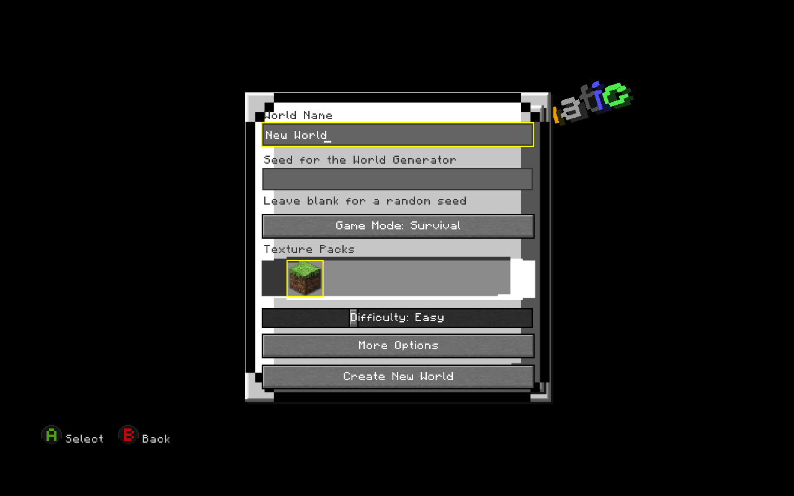
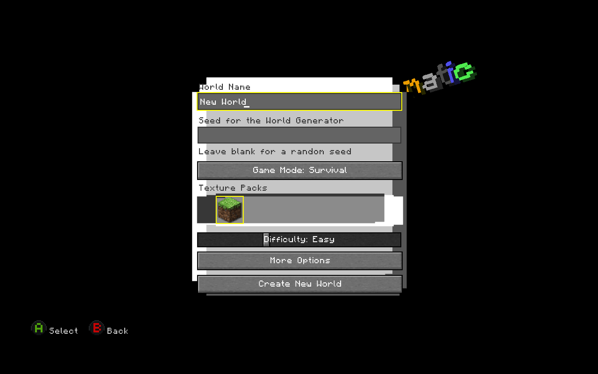
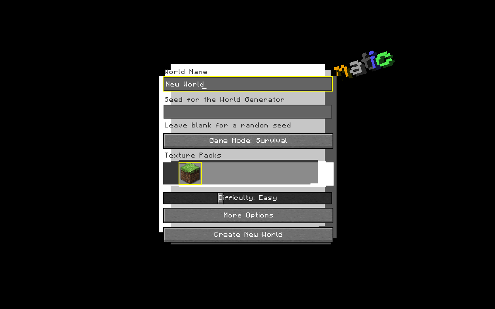
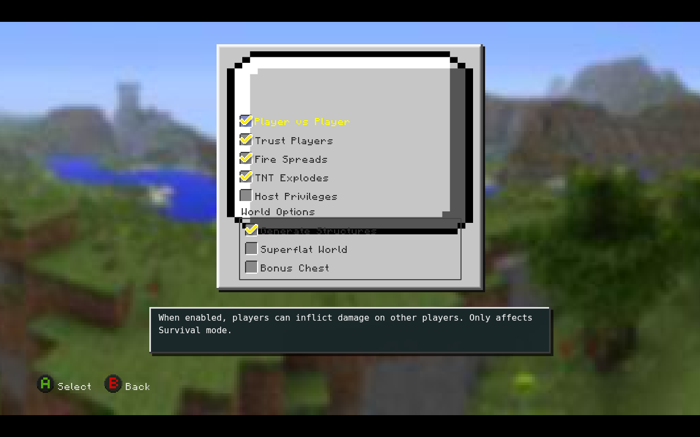
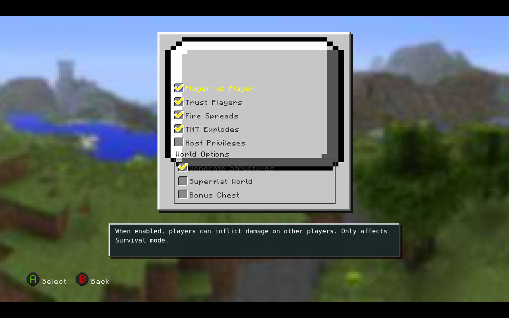
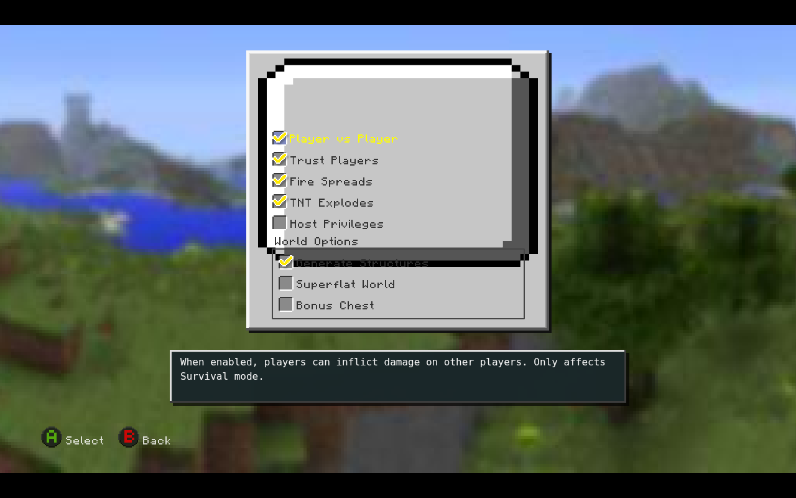
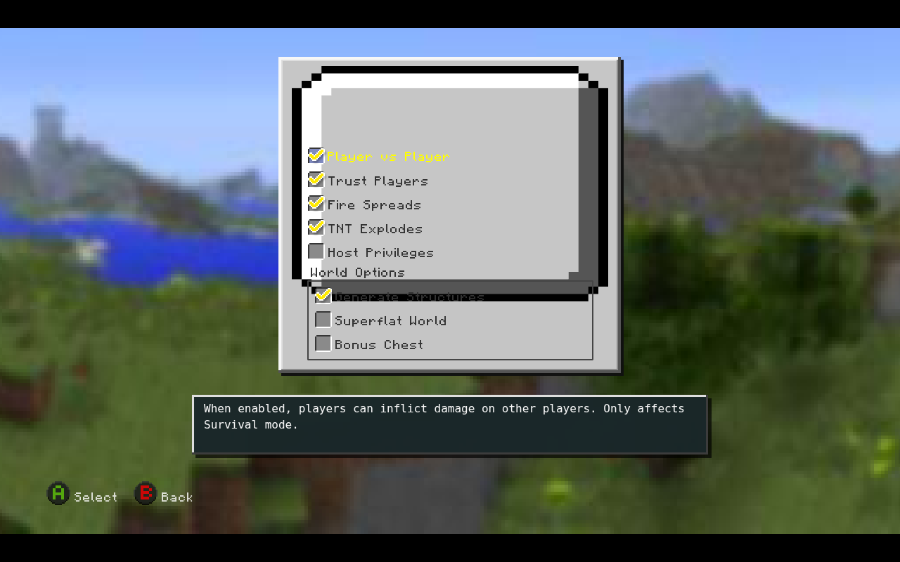
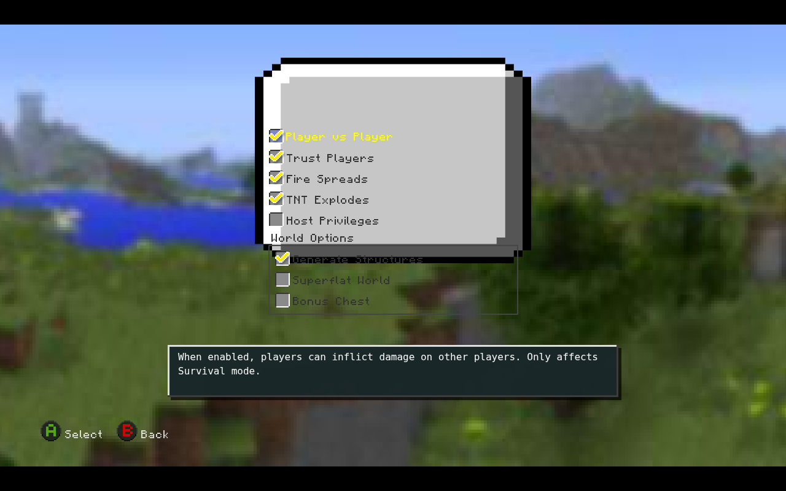
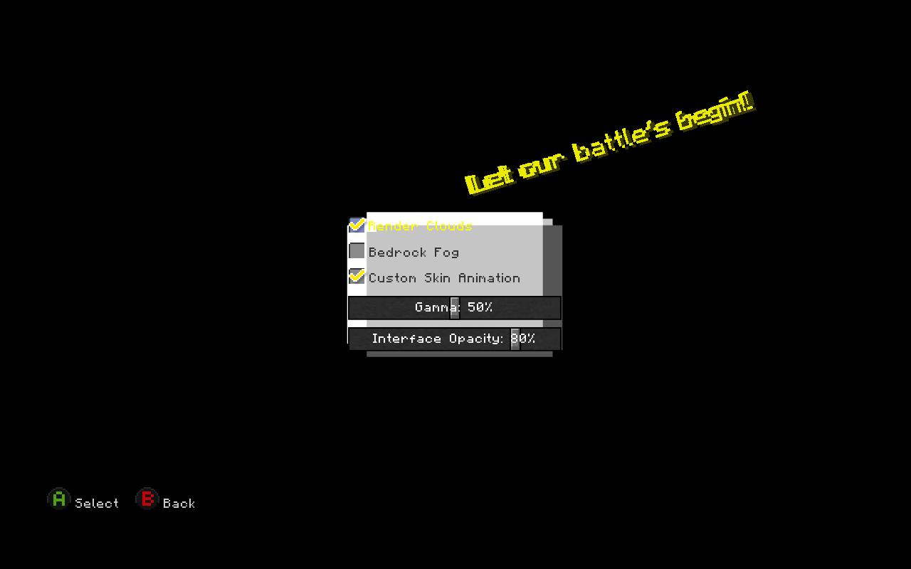
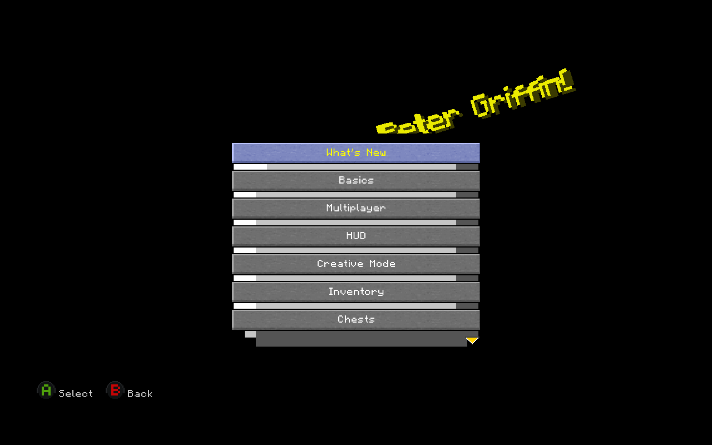

# Fix75 cross-menu tests — unmodified Chromium screenshots

The numbered images compare original canvas/SWF and native overlays; open individually.

## 01-create-normal.png

## 02-create-without-native-panel.png

## 03-options-normal.png

## 04-options-after-set.png

## 05-options-set-later.png

## 06-options-continuous.png

## 07-options-after-continuous.png

## 08-options-without-native-panel.png

## 09-graphics-original.png

## 10-graphics-hide-overlays.png

## 11-howto-original.png

## 12-howto-hide-overlays.png

