# Fix76 real browser screenshots

These are raw Playwright screenshots, **not** polished reference images.

15 screenshots

## 01-create-world

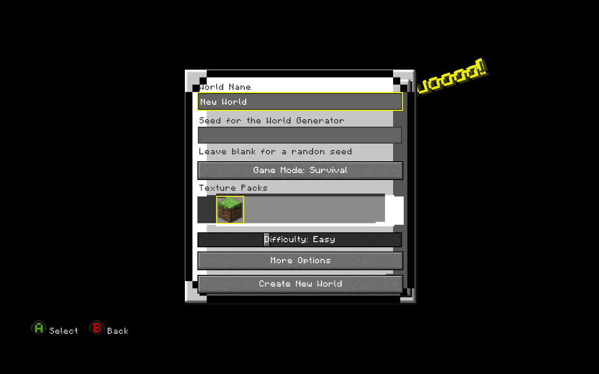

## 02-options-1.5s

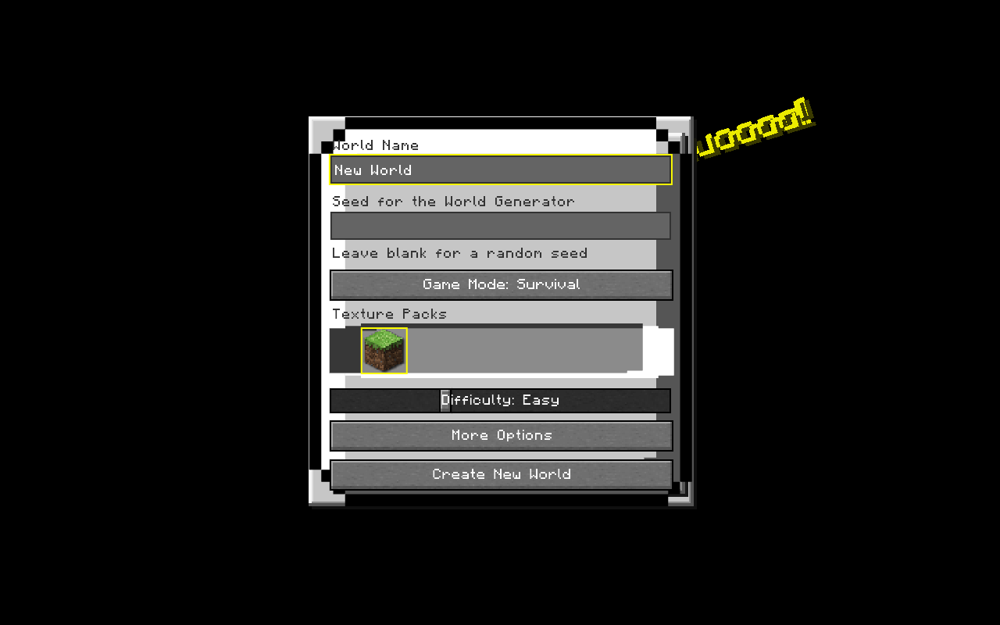

## 03-options-4.3s

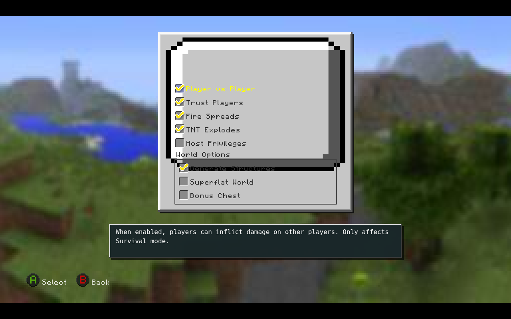

## 04-options-after-navigate

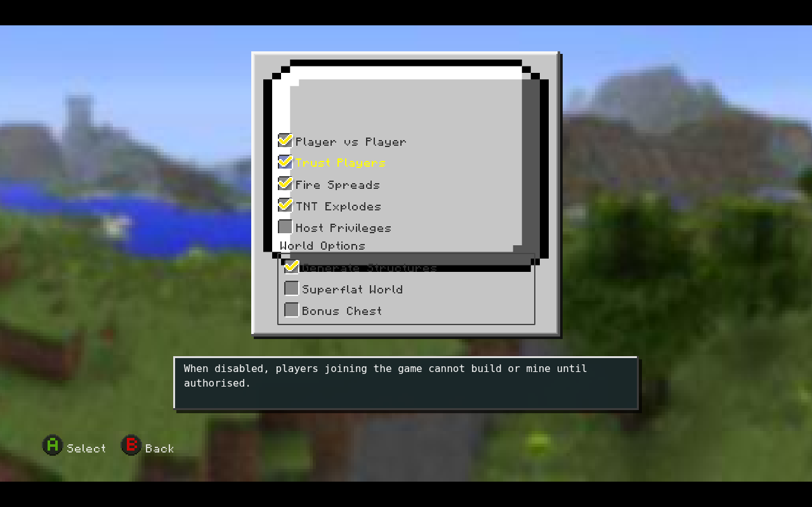

## 05-00-main-menu

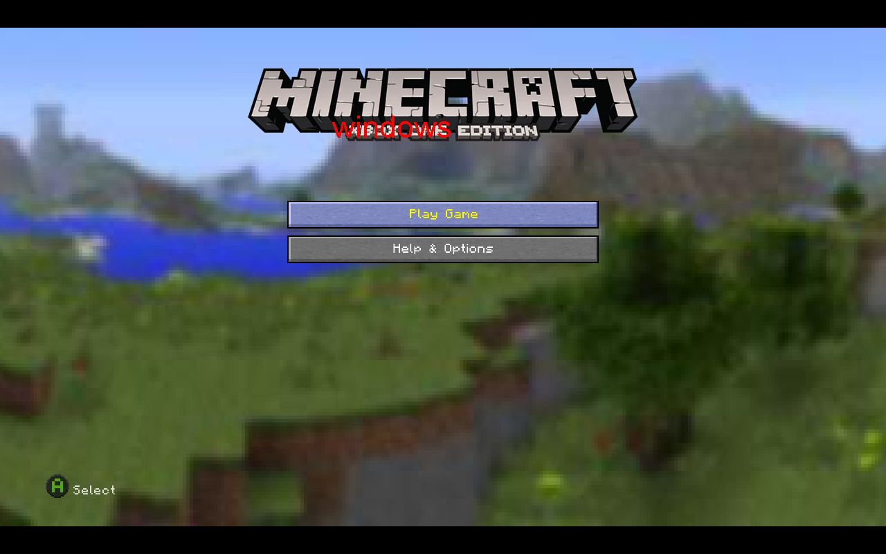

## 05-01-help-and-options

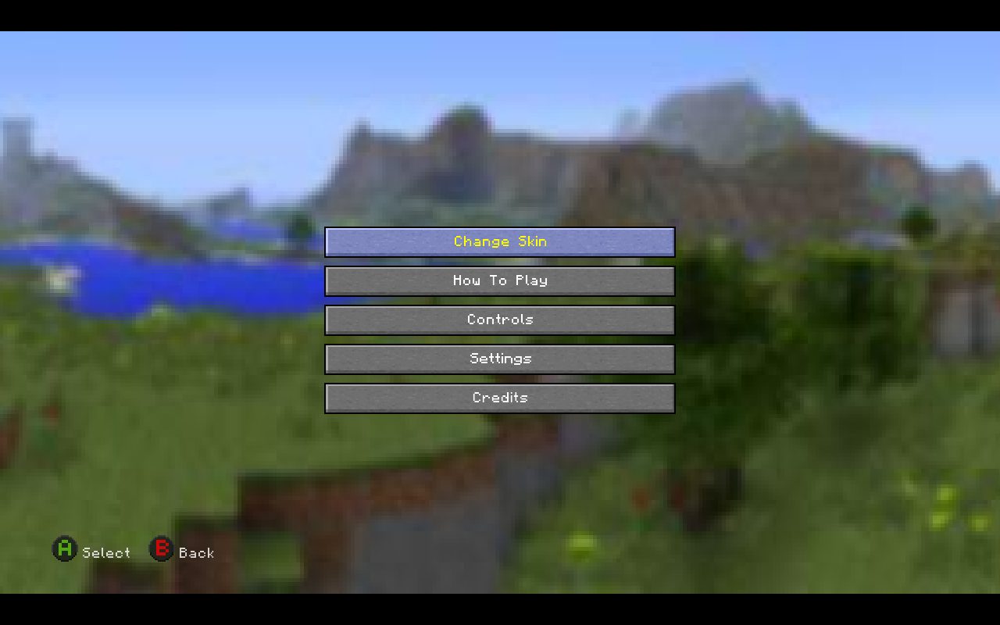

## 05-02-settings

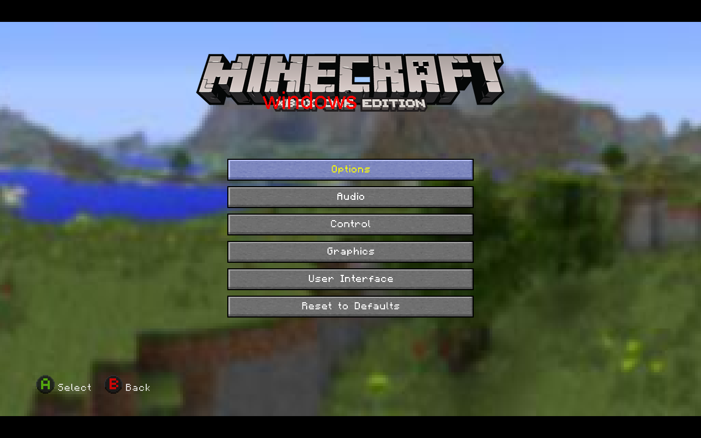

## 05-03-settings-options

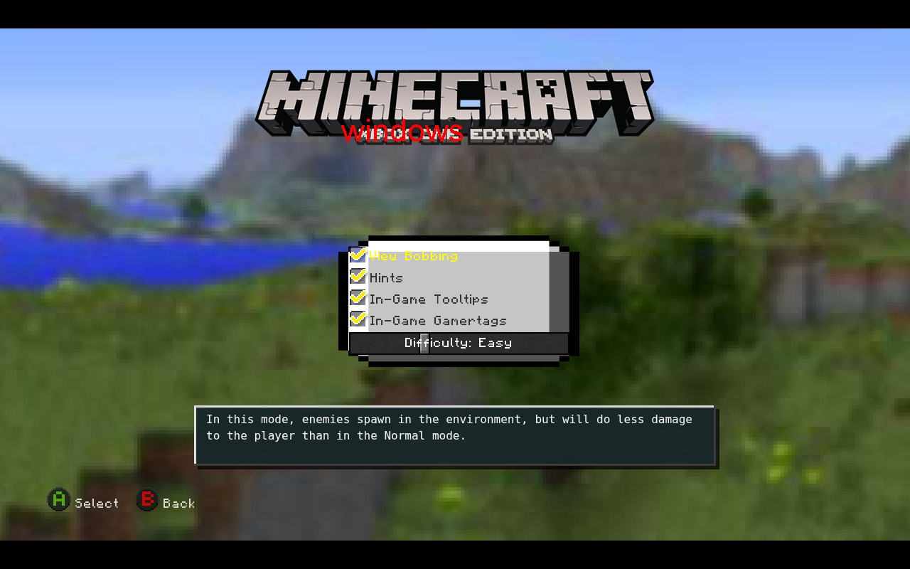

## 05-04-settings-audio

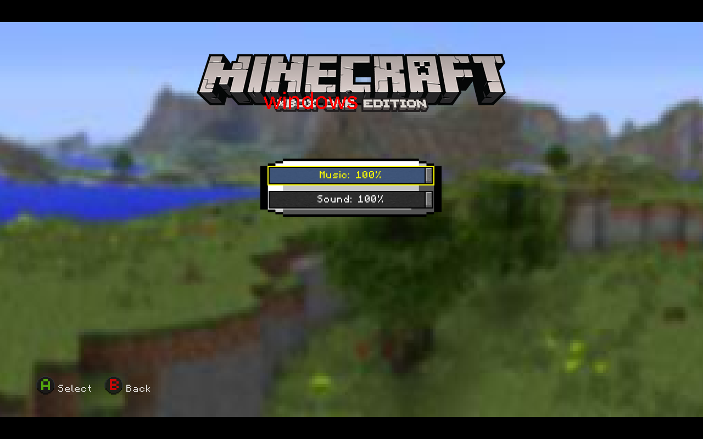

## 05-05-settings-control

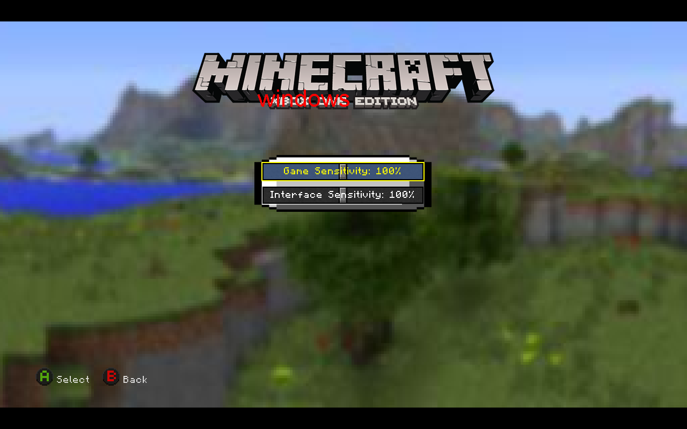

## 05-06-settings-graphics

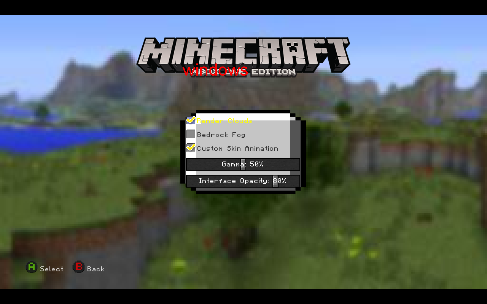

## 05-07-settings-UI

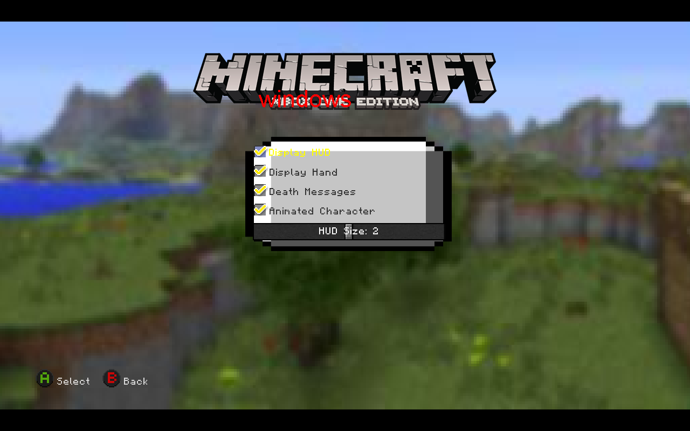

## 05-08-how-to-play

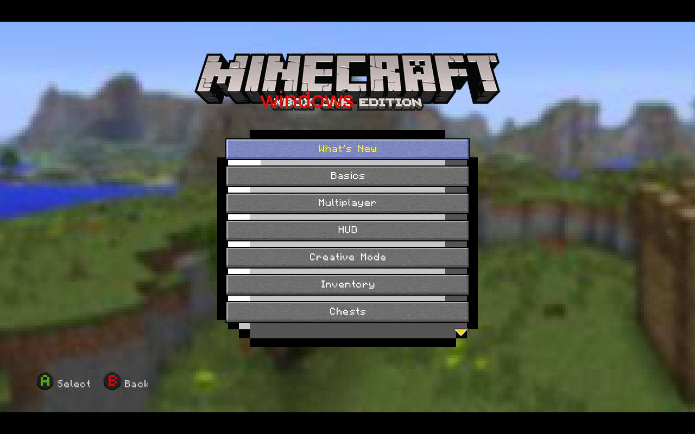

## 05-09-controller-layout

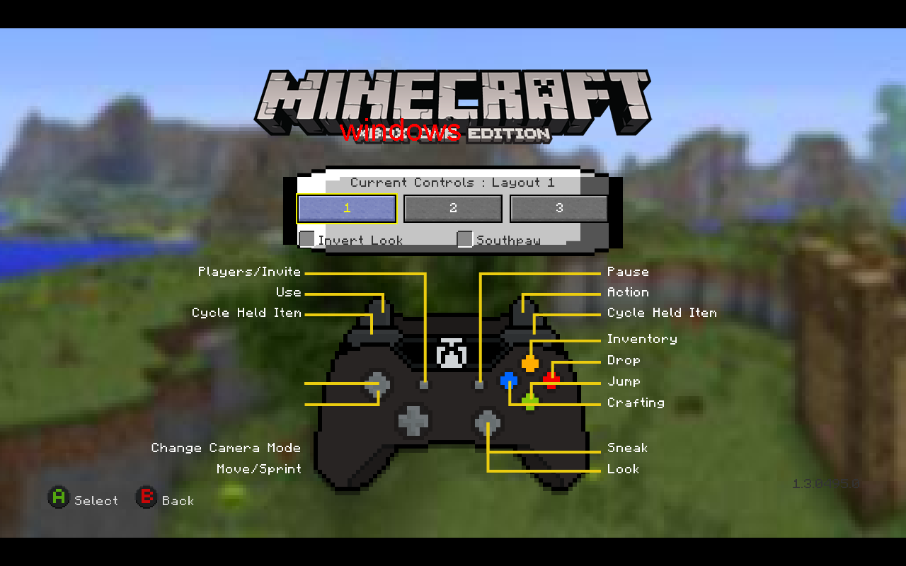

## 05-10-skin-select

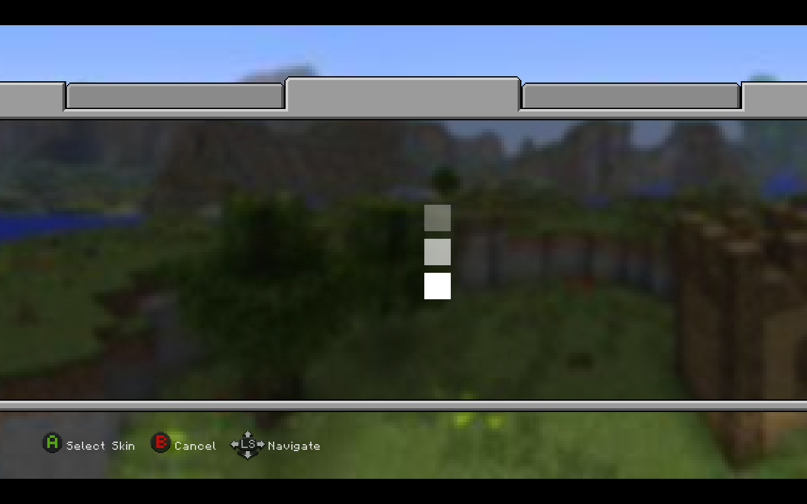
