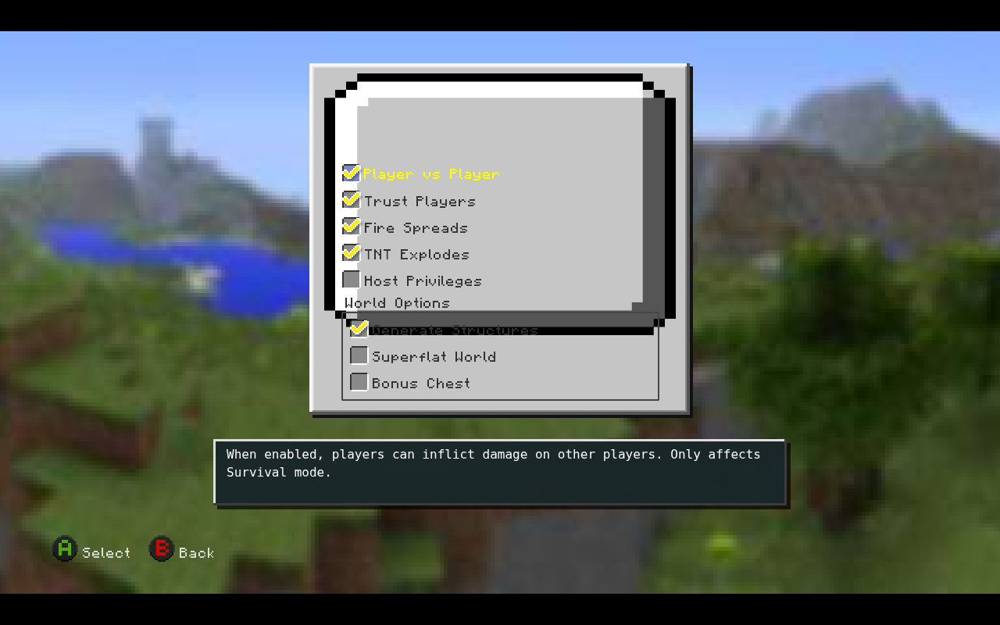
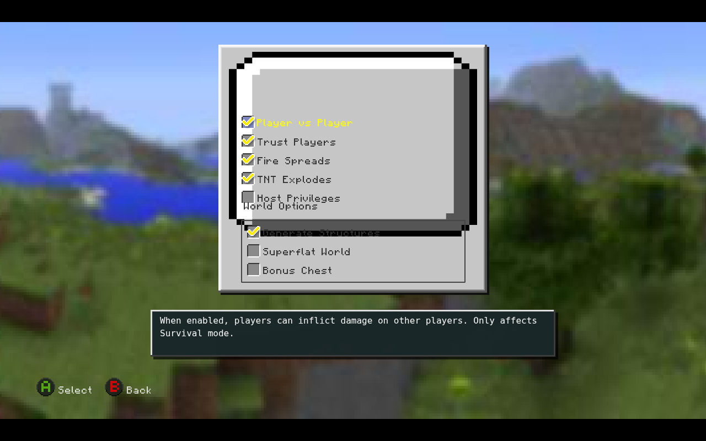
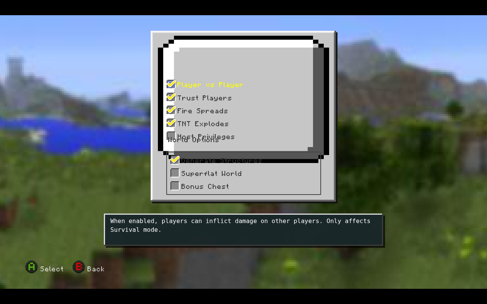
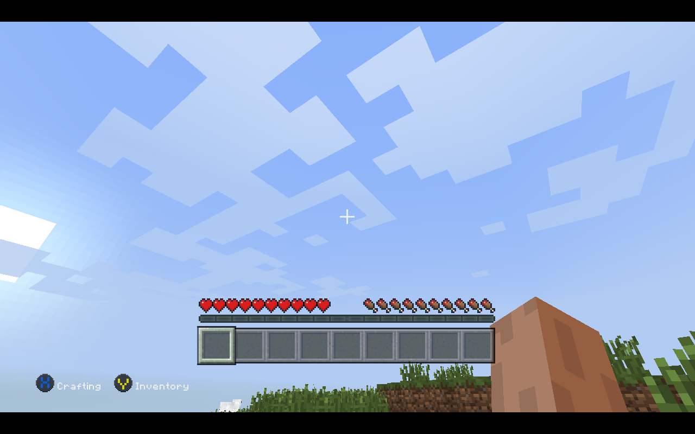
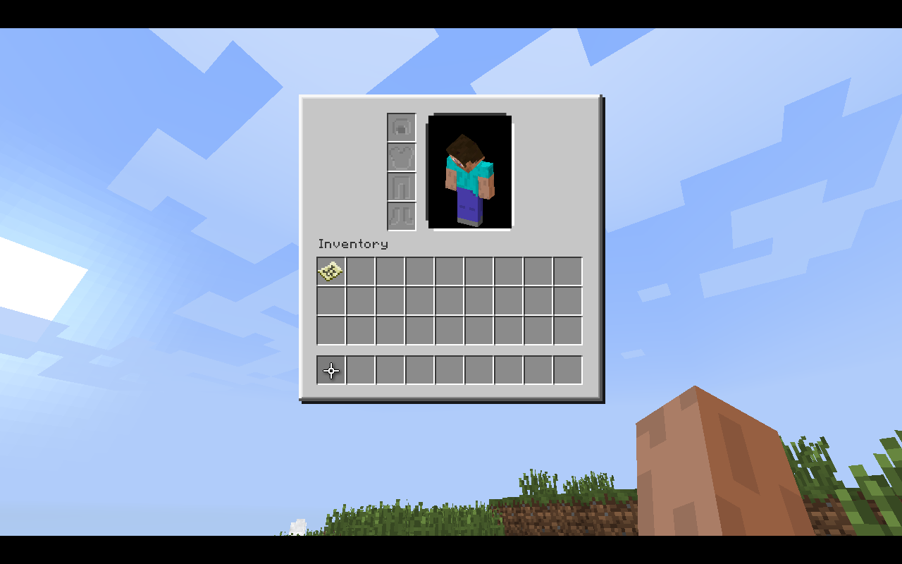
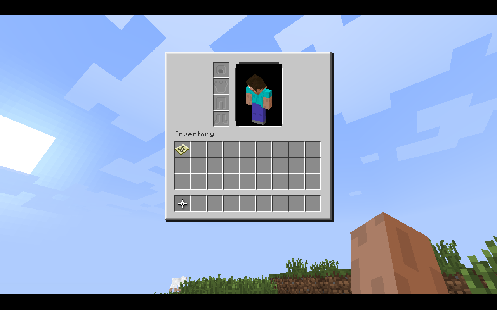

# Fix77 actual LCE screen comparisons

This diagnostic changes native SWF coordinates only for the before/after probes.

## 01-world-options-existing-divider

## 02-world-options-header-up14

## 03-world-options-header-up20

## 04-world-before-inventory

## 05-inventory-4s

## 06-inventory-10sec

