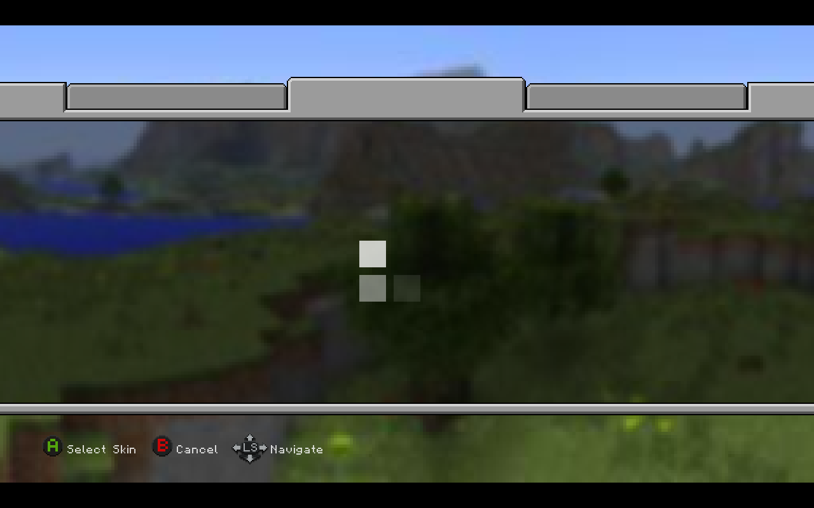
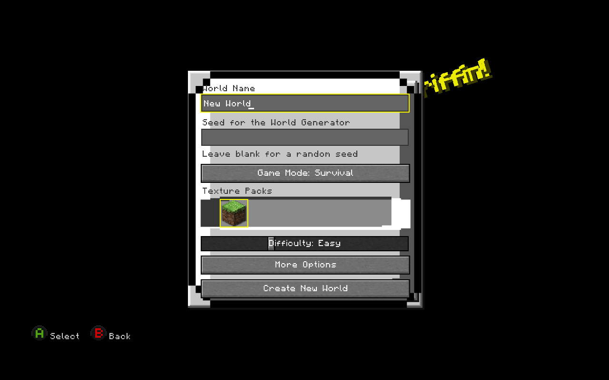
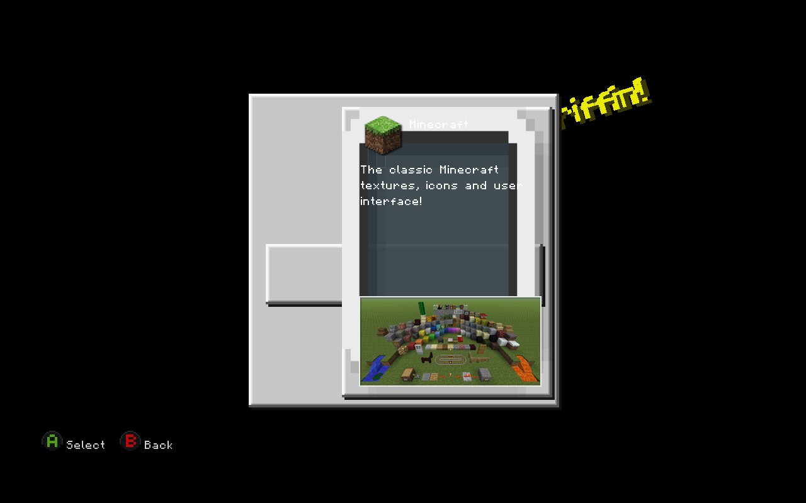
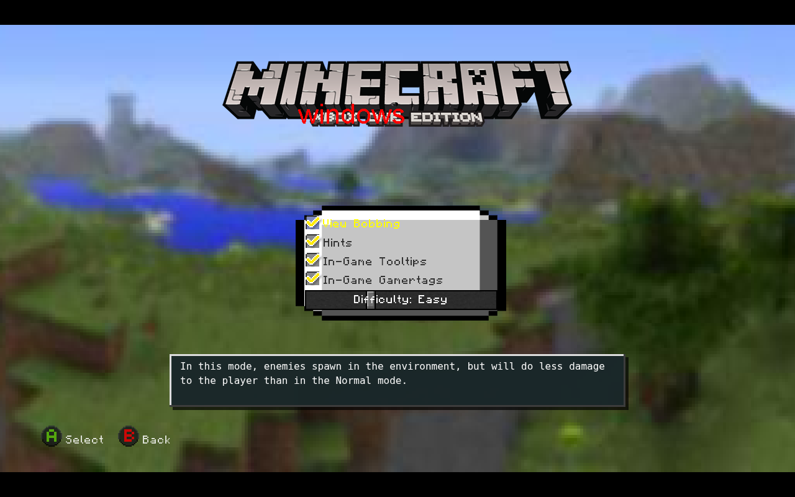
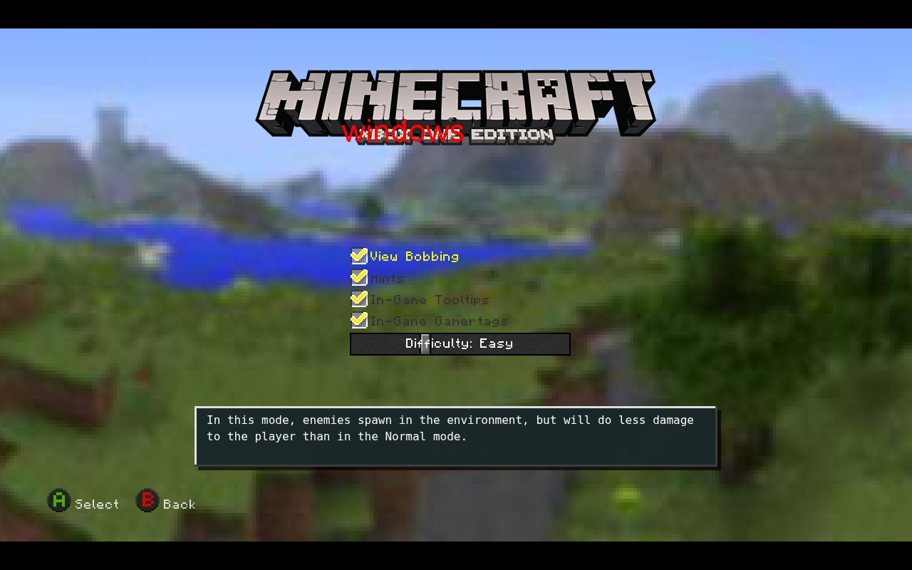
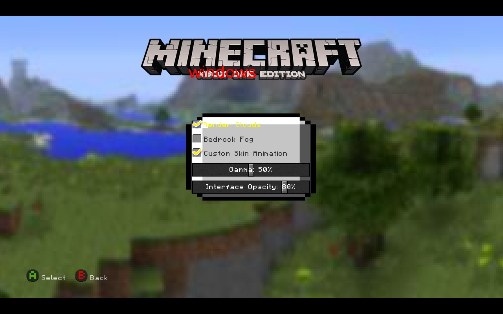
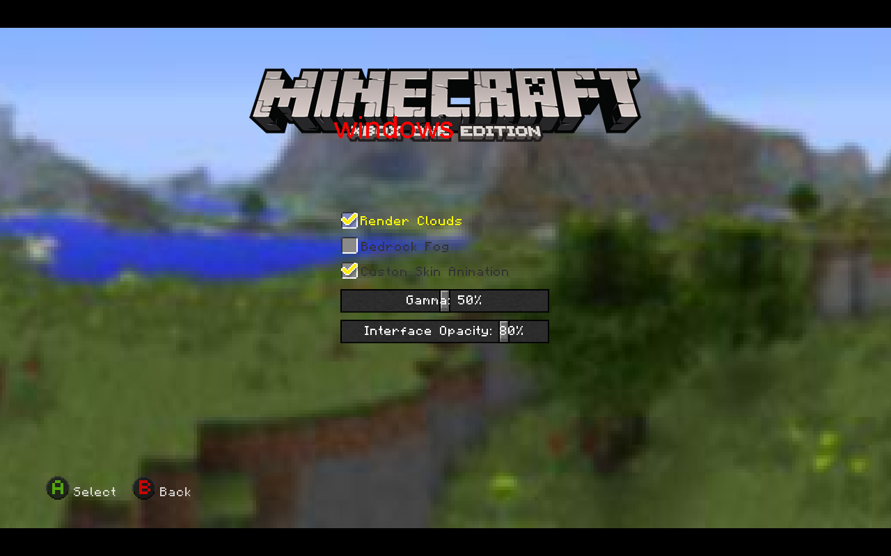
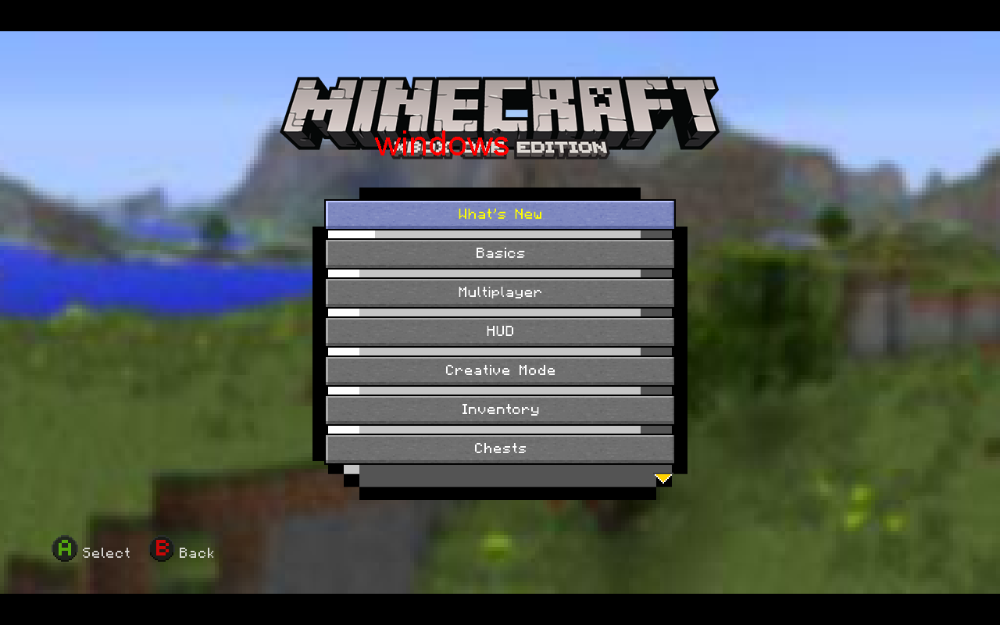

# Original scale9 frame isolation tests

Each screenshot uses the original SWF; only the indicated original Flash panel clip is temporarily hidden.

## 10-skin-select-baseline

## 12-create-world-baseline

## 12-create-world-hide-MainPanel

## 3-settings-options-baseline

## 3-settings-options-hide-BackgroundPanel

## 6-settings-graphics-baseline

## 6-settings-graphics-hide-BackgroundPanel

## 8-how-to-play-baseline

